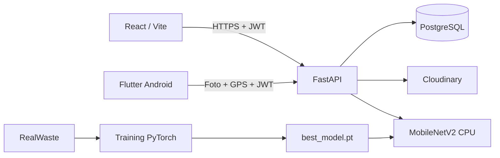
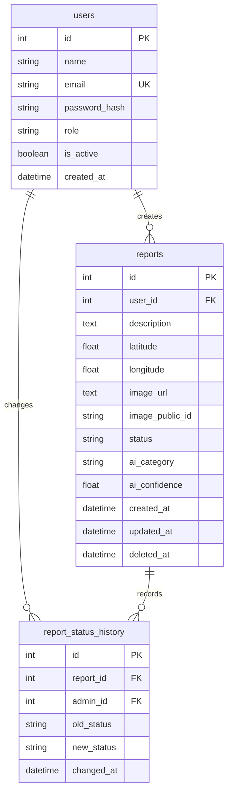

# Arsitektur dan ERD CamPah

Web dan Android menggunakan API yang sama. Dependency autentikasi memuat akun dari database pada setiap permintaan, sehingga penonaktifan akun langsung memblokir token yang sudah diterbitkan. Pemeriksaan kepemilikan berada di API. UI juga menyembunyikan operasi laporan yang tidak diizinkan.

Pembuatan laporan memvalidasi foto, mengoreksi orientasi kamera, menyimpan foto, lalu menyimpan laporan Pending di database. Inferensi dijalankan melalui thread pool dan hasilnya ditambahkan ke laporan. Kegagalan inferensi tidak membatalkan laporan yang telah disimpan. Pengembangan lokal dapat menggunakan SQLite dan folder uploads; deployment menggunakan PostgreSQL dan Cloudinary.

## ERD

Email memiliki unique index. Laporan memiliki index pada pemilik dan status; riwayat status memiliki index report_id. Role/status divalidasi di API. Tanggal ditulis dalam UTC dan dapat diformat menurut zona waktu perangkat. Penghapusan laporan mengisi `deleted_at`; akun dinonaktifkan melalui `is_active` agar relasi laporan tetap utuh.

## Batas akses

| Operasi | User | Admin |
| --- | --- | --- |
| Lihat laporan dan dashboard | Milik sendiri | Semua |
| Buat laporan | Ya | Ya |
| Ubah/hapus laporan | Milik sendiri, Pending | Semua |
| Ubah status | Tidak | Ya |
| Kelola pengguna | Tidak | Ya |
| Prediksi gambar | Ya | Ya |

Migrasi awal ada di `api/migrations/versions/001_initial.py`; `python api/start.py` menerapkan migrasi sebelum menjalankan server. GitHub Actions memeriksa migrasi terhadap PostgreSQL 16 dan mencocokkan metadata ORM dengan skema hasil migrasi.
