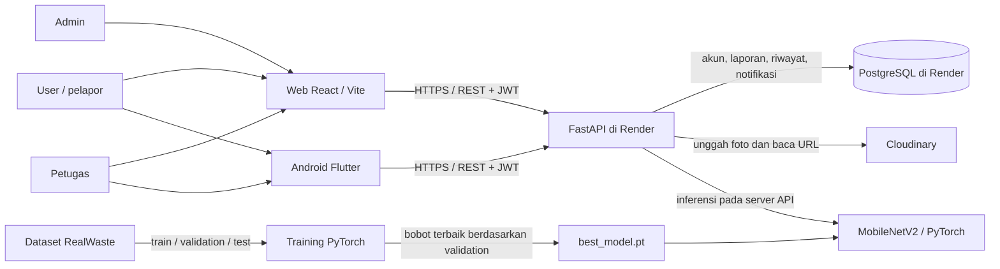
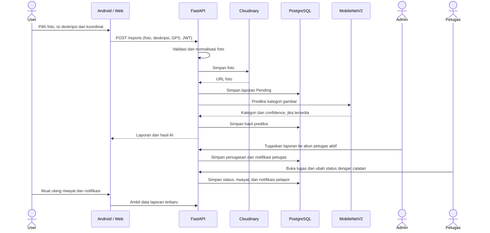
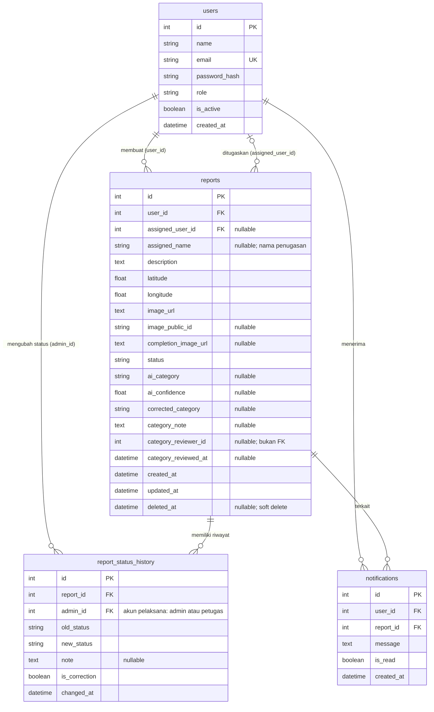

# Arsitektur dan ERD CamPah

Dokumen ini menggambarkan implementasi CamPah: web React, Android Flutter, API FastAPI, PostgreSQL, penyimpanan foto Cloudinary, dan model klasifikasi gambar MobileNetV2.

## Arsitektur sistem

Web diterbitkan sebagai Render Static Site; API berjalan sebagai Render Web Service. Android menggunakan URL API publik yang sama. Model dan kode inferensi berjalan di proses API, sehingga model bukan layanan terpisah. Cloudinary menyimpan foto; PostgreSQL menyimpan URL foto dan data aplikasi. Untuk pengembangan lokal, proyek juga mendukung SQLite dan folder unggahan lokal.

- Web: https://campah-web.onrender.com
- Dokumentasi API interaktif: https://campah-api.onrender.com/docs
- Kode dan model: https://github.com/MhmmdIchsan/CamPah

## Alur laporan dan tindak lanjut

Laporan disimpan sebelum inferensi. Jika prediksi gagal, laporan tetap tersedia dengan hasil AI kosong. Alur normal status adalah **Pending → In Progress → Completed**; Pending atau In Progress juga dapat berubah ke Rejected. Admin dapat membuat koreksi status dengan alasan. API memakai `expected_status` untuk menolak perubahan ketika status sudah berubah sejak laporan dibuka.

## ERD

`reports.user_id` menunjuk pembuat laporan; `reports.assigned_user_id` menunjuk akun petugas yang ditugaskan dan boleh kosong. `assigned_name` menyimpan nama untuk tampilan dan mempertahankan data penugasan lama. Kolom `category_reviewer_id` menyimpan ID peninjau tanpa constraint foreign key; fitur tinjau kategori saat ini tidak ditampilkan pada web. Walaupun kolom pelaksana riwayat bernama `admin_id`, nilainya dapat merujuk akun Admin atau Petugas.

Email memiliki unique index. API memeriksa role, kepemilikan, penugasan, dan status pengguna pada akses data; role dan status bukan database enum. Penghapusan laporan memakai `deleted_at`, sedangkan pengguna dapat dinonaktifkan dengan `is_active`. Penonaktifan akun membuat token yang sudah diterbitkan tidak dapat digunakan. Timestamp disimpan dalam UTC dan ditampilkan sesuai format aplikasi.

## Hak akses yang dipakai antarmuka

| Operasi | User | Petugas | Admin |
| --- | --- | --- | --- |
| Dashboard dan detail laporan | Laporan milik sendiri | Laporan yang ditugaskan | Semua laporan |
| Membuat laporan melalui antarmuka | Ya | Tidak tersedia | Ya, melalui web |
| Ubah/hapus isi laporan | Milik sendiri saat Pending | Tidak | Semua |
| Ubah status dengan catatan | Tidak | Laporan yang ditugaskan | Semua |
| Koreksi status | Tidak | Tidak | Ya |
| Tugaskan petugas dan kelola pengguna | Tidak | Tidak | Ya |
| Lihat notifikasi | Milik sendiri | Milik sendiri | Milik sendiri |

API `POST /reports` dan `/predict` menerima akun yang telah login; tabel di atas membedakan ketersediaan menu antarmuka. Akses data dan penugasan tetap diperiksa di server. Riwayat migrasi berada di `api/migrations/versions/`; `python api/start.py` menerapkannya sebelum API dimulai. GitHub Actions memeriksa migrasi PostgreSQL dan pengujian API.

## Model dan batas hasil

Model memakai tiga kelas: Organic Waste, Plastic Waste, dan Paper Waste. Data RealWaste yang dipilih berjumlah 600 gambar: 420 training, 90 validation, dan 90 test. Checkpoint dipilih memakai validation; hasil test terpisah adalah 87 benar dari 90 gambar atau **96,67%**. Angka tersebut berlaku untuk split tersebut dan belum membuktikan ketepatan pada semua kondisi lapangan. Rincian sumber dan batas lisensi ada di [DATASET.md](../ml/DATASET.md), sedangkan metode dan metrik ada di [MODEL_CARD.md](../ml/MODEL_CARD.md).
